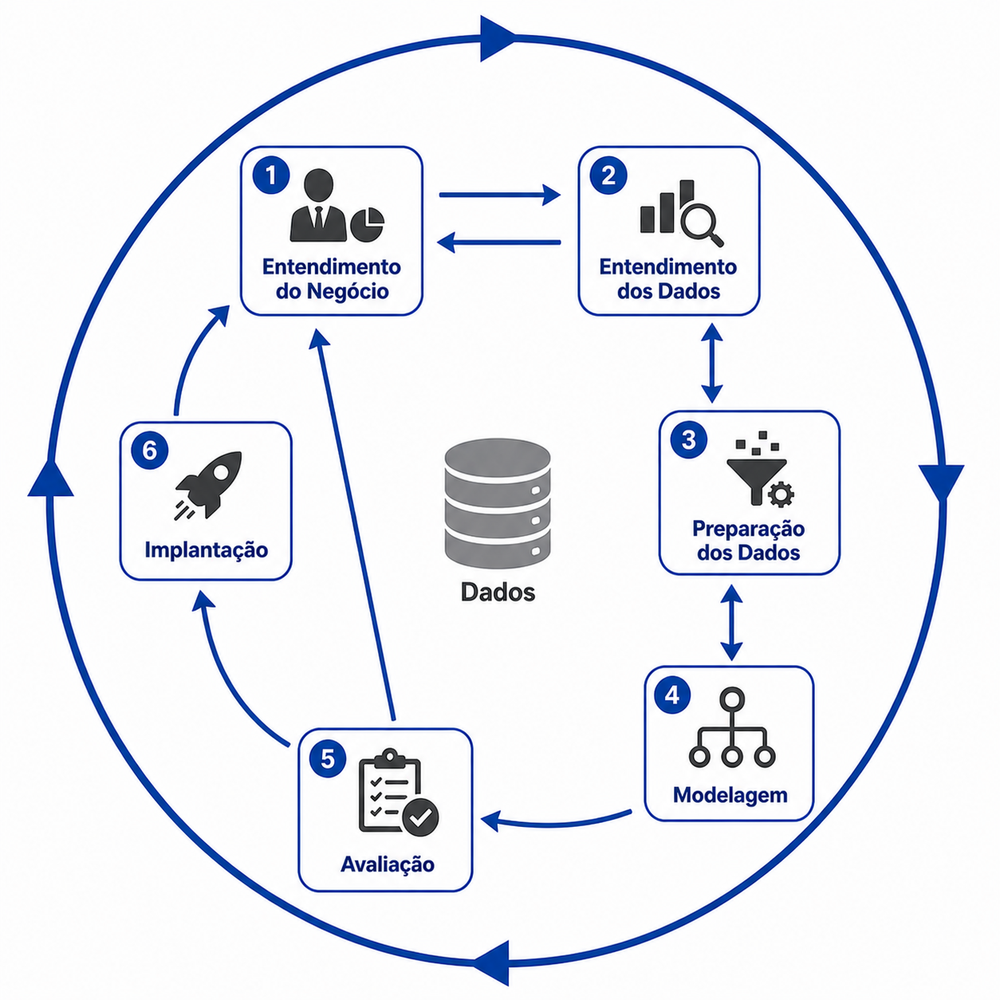
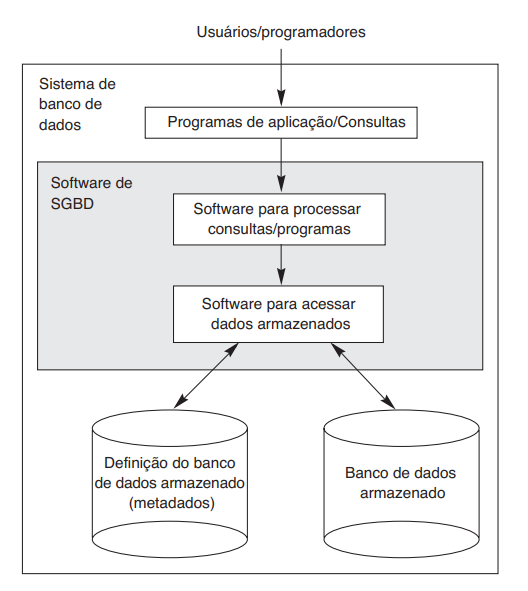

### Por que estudar banco de dados

</br>

::: lado
<div>

-   **Bancos de dados** e sistemas de banco de dados são componentes
    essenciais da sociedade moderna.

</br>

-   No cotidiano, muitas **atividades dependem** de banco de dados,
    mesmo quando isso não é visível para o usuário.

</div>

::: {.painel .fragment}
##### Onde podemos usar Banco de Dados no dia a dia?

-   Sistemas de hospital
-   Prontuário eletrônico
-   Aplicativos Mobile
-   E-commerce
-   Supermercados
:::
:::

## O que são dados ?

<br>

*Definição simples:* Os dados são informações brutas.

<br>

::: {.painel .fragment}
##### Exemplos

-   Nome
-   Idade
-   Resultado de exame
-   Data de atendimento
:::

<br>

::: fragment
::: nota
Podemos utilizar *Banco de dados* para manter informações referentes a
pacientes, médicos, consultas e exames em um ambiente hospitalar.
:::
:::

------------------------------------------------------------------------

#### Exemplo: um banco de dados na saúde

::: lado
::: {.tb .tb-pk}
PACIENTE

| id_paciente | nome  | idade |  cidade   |
|:-----------:|:-----:|:-----:|:---------:|
|      1      | Maria |  39   | Fortaleza |
|      2      | João  |  52   |  Recife   |
|      3      |  Ana  |  27   |   Natal   |
:::

::: {.tb .tb-pk}
MEDICO

| id_medico |  nome  |  crm  | especialidade |
|:---------:|:------:|:-----:|:-------------:|
|     1     | Paulo  | 10234 |  Cardiologia  |
|     2     | Helena | 20871 |   Ortopedia   |
|     3     | Clara  | 30456 | Dermatologia  |
:::
:::

::: lado
::: {.tb .tb-pk .tb-fk}
CONSULTA

| id_consulta | id_paciente | id_medico |   data   |
|:-----------:|:-----------:|:---------:|:--------:|
|     10      |      1      |     1     | 12/08/26 |
|     11      |      2      |     2     | 13/05/26 |
|     13      |      3      |     3     | 14/11/26 |
:::

::: {.tb .tb-pk .tb-fk}
EXAME

| id_exame | id_consulta |   tipo   | resultado |
|:--------:|:-----------:|:--------:|:---------:|
|   501    |     10      | Cardíaco |  Normal   |
|   502    |     11      |  Imagem  | Alterado  |
|   503    |     13      |  Sangue  |  Normal   |
:::
:::

::: {.nota .fragment}
Repare que as tabelas estão relacionadas (`id_paciente`, `id_medico`,
`id_consulta`). Ao longo do módulo vamos entender cada peça desse
quebra-cabeça.
:::

------------------------------------------------------------------------

### O que é um Banco de Dados?

Dados são informações que nos permite chegar ao conhecimento de algo.

::: fluxo
::: caixa
::: {.titulo .t1}
Dados
:::

-   1 Compra online
-   1 transferência bancária
-   1 curtida em uma foto do Instagram
:::

::: seta
→
:::

::: caixa
::: {.titulo .t2}
Tabela
:::

-   Diversas compras online
-   Diversas transferências bancárias
-   Diversas curtidas em fotos do Instagram
:::

::: seta
→
:::

::: caixa
::: {.titulo .t3}
Banco de Dados
:::

-   Informações de compras online, usuários, histórico de produtos, etc
-   Informações de contas bancárias, histórico de transferências, dados
    dos usuários, etc
-   Curtidas em fotos, informações de preferências dos usuários, etc
:::
:::

------------------------------------------------------------------------

### Por que não usar planilha pra tudo?

Um lugar onde os dados ficam organizados e guardados de forma
estruturada resolve problemas que uma planilha não resolve bem:

-   Volume de dados
-   Duplicidade de informação
-   Dificuldade de relacionar dados

::: lado
::: {.nota .fragment}
#### Concorrência

várias pessoas mexendo no mesmo arquivo ao mesmo tempo.
:::

::: {.nota .fragment}
#### Confiabilidade das informações

o banco aplica regras (tipo do dado, campos obrigatórios, chaves) que
evitam dados errados ou duplicados.
:::
:::

::: lado
::: {.nota .fragment}
#### Segurança dos dados

Controle de acesso por perfil (nem todo mundo pode ver ou alterar tudo),
registro de quem acessou e backup para recuperar o que for perdido.
:::

::: {.nota .fragment}
#### LGPD

Dados pessoais são dados sensíveis, protegidos pela LGPD (Lei nº
13.709/2018).
:::
:::

------------------------------------------------------------------------

### Impacto de Banco de dados

</br>

-   Os bancos de dados e sua tecnologia têm um impacto importante sobre
    o uso crescente dos computadores.

</br>

-   É correto afirmar que os bancos de dados desempenham um papel
    crítico em quase todas as áreas em que os computadores são usados,
    incluindo negócios, comércio eletrônico, engenharia, medicina,
    genética, direito, educação e biblioteconomia.

------------------------------------------------------------------------

### CRISP-DM

O Banco de dados é peça fundamental no fluxo de trabalho de todo
estatístico e cientista de dados.

{width="70%" height="auto" fig-align="center"}

------------------------------------------------------------------------

### Aplicações tradicionais de banco de dados

</br>

-   Predominância de dados textuais e numéricos
-   Cadastro de clientes, produtos e serviços
-   Registro de transações comerciais
-   Geração de relatórios operacionais

Essas aplicações formam a base dos sistemas de informação em empresas e
instituições.

------------------------------------------------------------------------

### Aplicações modernas

</br>

-   Bancos de dados multimídia: armazenamento de imagens, áudio e vídeo
-   GIS (Sistemas de Informação Geográfica): mapas, dados climáticos e
    imagens de satélite
-   Data warehousing e processamento analítico online (OLAP — On-Line
    Analytical Processing): análise de grandes volumes de dados para
    decisão

## SGBD

O SGBD (Sistema de Gerenciamento de Banco de Dados) é o programa que
gerencia o Banco: cria, organiza, protege e permite consultar os dados.
Os principais SGBDs do mercado são:

```{=html}
<div style="display:grid; grid-template-columns: repeat(3, 1fr); gap:18px; margin-top:12px;">

  <div style="background:#f8fafc; border:1px solid #dbe5f1; border-radius:14px; padding:14px; text-align:center;">
    
    <div style="margin-top:8px; font-weight:600; color:#23395b;">PostgreSQL</div>
  </div>

  <div style="background:#f8fafc; border:1px solid #dbe5f1; border-radius:14px; padding:14px; text-align:center;">
    
    <div style="margin-top:8px; font-weight:600; color:#23395b;">MySQL</div>
  </div>

  <div style="background:#f8fafc; border:1px solid #dbe5f1; border-radius:14px; padding:14px; text-align:center;">
    
    <div style="margin-top:8px; font-weight:600; color:#23395b;">SQLite</div>
  </div>

  <div style="background:#f8fafc; border:1px solid #dbe5f1; border-radius:14px; padding:14px; text-align:center;">
    
    <div style="margin-top:8px; font-weight:600; color:#23395b;">Oracle Database</div>
  </div>

  <div style="background:#f8fafc; border:1px solid #dbe5f1; border-radius:14px; padding:14px; text-align:center;">
    
    <div style="margin-top:8px; font-weight:600; color:#23395b;">SQL Server</div>
  </div>

  <div style="background:#f8fafc; border:1px solid #dbe5f1; border-radius:14px; padding:14px; text-align:center;">
    
    <div style="margin-top:8px; font-weight:600; color:#23395b;">MongoDB</div>
  </div>

  <div style="background:#f8fafc; border:1px solid #dbe5f1; border-radius:14px; padding:14px; text-align:center;">
    
    <div style="margin-top:8px; font-weight:600; color:#23395b;">Cassandra</div>
  </div>

  <div style="background:#f8fafc; border:1px solid #bec7d2; border-radius:14px; padding:14px; text-align:center;">
    
    <div style="margin-top:8px; font-weight:600; color:#23395b;">Hive</div>
  </div>

  <div style="background:#f8fafc; border:1px solid #dbe5f1; border-radius:14px; padding:14px; text-align:center;">
    
    <div style="margin-top:8px; font-weight:600; color:#23395b;">Db2</div>
  </div>

</div>
```

------------------------------------------------------------------------

### Como aplicações usam o SGBD

</br>

-   Aplicações **acessam o banco** por meio de **consultas** e
    **transações**.
-   Consultas **recuperam** dados; transações **leem** e **gravam**
    informações.
-   O SGBD também oferece **proteção** contra \*falhas **e controle de**
    segurança\*\*.
-   Como bancos de dados têm ciclo de vida longo, o SGBD precisa
    sustentar **manutenção e evolução contínuas**.
-   É **possível criar um sistema próprio**, mas isso exige muito
    software complexo; por isso, na prática, usa-se SGBD de mercado.

------------------------------------------------------------------------

### Sistema de banco de dados

</br>

::: columns
::: {.column width="40%"}
</br>

</br>

::: painel
Para completar nossas definições iniciais, chamaremos a união do banco
de dados com o software de SGBD de **sistema de banco de dados**.
:::
:::

::: {.column width="60%"}
{width="70%" height="auto"}
:::
:::

------------------------------------------------------------------------

### Manipulação do banco de dados

<br>

A **manipulação** envolve duas operações principais:

-   **Consulta:** recuperar informações armazenadas.
-   **Atualização:** inserir, alterar ou remover dados para refletir
    mudanças nos dados.

<br>

::: painel
As solicitações são inicialmente descritas pelo usuário e depois
traduzidas para a linguagem de consulta do SGBD.
:::

## Como faço para manipular os dados ?

::: lado
<div>

::: fragment
**SQL** (*Structured Query Language*, ou Linguagem de Consulta
Estruturada) é a linguagem padrão usada para "conversar" com o SGBD:
criar, consultar e alterar os dados organizados em bancos de dados
relacionais.
:::

<br>

::: fragment
``` sql
SELECT nome 
FROM paciente;
```
:::

<br>

::: fragment
SQL "pergunta" coisas ao banco em um português quase legível.
:::

</div>

::: {.painel .fragment}
Antes de aprender SQL, você precisa entender:

1.  O que são dados
2.  O que é banco de dados
3.  Quem gerencia isso (SGBD)
4.  Como isso se relaciona

Só depois faz sentido escrever a primeira query.
:::
:::

## Entidade

Entidade é um grupo de informações ligadas entre si, necessárias para o
funcionamento do sistema. Normalmente representa algo do mundo real.

::: {.nota .fragment}
No banco de dados, cada entidade vira uma tabela.
:::

::: {.nota .fragment}
Uma entidade tem várias ocorrências: a entidade é "paciente" e a Maria é
uma ocorrência dela.
:::

::: fragment
::: {.tb .tb-pk}
EXEMPLO DE ENTIDADE: PACIENTE

| id_paciente | nome  | idade |  cidade   |
|:-----------:|:-----:|:-----:|:---------:|
|      1      | Maria |  39   | Fortaleza |
|      2      | João  |  52   |  Recife   |
|      3      |  Ana  |  27   |   Natal   |
:::
:::

## Exemplos e Tipos de Entidade

| Categoria          | Exemplos                                            |
|:-------------------|:----------------------------------------------------|
| Pessoas e empresas | paciente, funcionário, cliente, fornecedor, empresa |
| Documentos         | ordem de compra, pedido, nota fiscal                |
| Lugares            | almoxarifado, departamento                          |
| Materiais          | produtos, peças                                     |

<br>

::: fragment
As entidades se dividem em dois tipos:
:::

::: fragment
::: def
::: term
Fundamental
:::

::: desc
Guarda os dados básicos do sistema (paciente, médico)
:::
:::
:::

::: fragment
::: {.def .mint}
::: term
Associativa
:::

::: desc
Nasce da relação entre duas entidades fundamentais (consulta liga
paciente e médico)
:::
:::
:::

## Atributo e Tupla

::: {.tb .tb-tupla .c4}
Tabela paciente

| id_paciente | nome  | idade |  cidade   |
|:-----------:|:-----:|:-----:|:---------:|
|      1      | Maria |  39   | Fortaleza |
|      2      | João  |  52   |  Recife   |
|      3      |  Ana  |  27   |   Natal   |
:::

::: lado
::: {.def .fragment}
::: term
Atributo
:::

::: desc
Cada característica da entidade. Vira uma coluna (campo). Exemplo: nome,
idade, cidade.
:::
:::

::: {.def .mint .fragment}
::: term
Tupla
:::

::: desc
O conjunto de atributos de uma ocorrência. Vira uma linha (registro).
Exemplo: (1, Maria, 39, Fortaleza).
:::
:::
:::

::: {.nota .fragment}
Atributo não é entidade: o atributo é uma característica, e a entidade é
o grupo de atributos (no mínimo dois).
:::

::: {.nota .fragment}
E como saber qual tupla é qual? Algum atributo precisa identificar cada
linha de forma única. É aí que entram as chaves.
:::

## Chaves

::: def
::: term
Chave primária (PK)
:::

::: desc
A chave primária deve ser única e imutável para cada linha da entidade.
Toda tabela precisa ter uma: é ela que identifica cada registro.

Exemplo: `id_paciente` na tabela paciente e `id_consulta` na tabela
consulta
:::
:::

::: {.def .mint}
::: term
Chave Estrangeira (FK)
:::

::: desc
É a coluna de uma tabela que aponta para a chave primária de outra
tabela. É ela que cria o relacionamento entre as tabelas.

Exemplo: `id_paciente` na tabela consulta aponta para `id_paciente` na
tabela paciente
:::
:::


## Exemplos de Chaves

::: lado
::: {.tb .tb-pk}
Chave primária

| id_paciente | nome  | idade |
|:-----------:|:-----:|:-----:|
|      1      | Maria |  39   |
|      2      | João  |  52   |
:::

::: {.tb .tb-fk}
Chave estrangeira

| id_consulta | id_paciente | especialidade |
|:-----------:|:-----------:|:---------------:|
|     10      |      1      |  Cardiologia  |
|     11      |      2      |   Ortopedia   |
:::
:::

::: {.nota .fragment}
Juntando as duas em uma tabela só:
:::

::: {.lado .fragment}
::: {.tb .tb-pk}
Tabela paciente

| id_paciente | nome  |  cidade   |
|:-----------:|:-----:|:---------:|
|      1      | Maria | Fortaleza |
|      2      | João  |  Recife   |
:::

::: {.tb .tb-pk .tb-fk }
Tabela consulta

| id_consulta | id_paciente | especialidade |
|:-----------:|:-----------:|:---------------:|
|     10      |      1      |  Cardiologia  |
|     11      |      2      |   Ortopedia   |
:::
:::

# Linguagem SQL

## Funções Básicas do SQL

Agora que já entendemos dados, tabelas e chaves, vamos conhecer os
comandos que usamos para trabalhar com eles.

| Função            | O que faz                            | Tipo de linguagem          |
|:-----------------|:-----------------------------|:------------------------|
| `CREATE DATABASE` | Cria o banco de dados                | Definição de dados (DDL)   |
| `CREATE TABLE`    | Cria uma tabela dentro do banco      | Definição de dados (DDL)   |
| `INSERT INTO`     | Adiciona uma nova linha na tabela    | Manipulação de dados (DML) |
| `UPDATE`          | Altera dados que já existem          | Manipulação de dados (DML) |
| `DELETE`          | Remove linhas da tabela              | Manipulação de dados (DML) |
| `SELECT`          | Escolhe as colunas que você quer ver | Consulta de dados (DQL)    |
| `FROM`            | Diz de qual tabela os dados vêm      | Consulta de dados (DQL)    |
| `WHERE`           | Filtra as linhas por uma condição    | Consulta de dados (DQL)    |
| `ORDER BY`        | Ordena o resultado                   | Consulta de dados (DQL)    |
| `COUNT()`         | Conta quantas linhas existem         | Consulta de dados (DQL)    |

------------------------------------------------------------------------

## Criando um Banco de Dados

<br>

Antes de criar as tabelas, precisamos criar o banco onde elas vão ficar
alocadas.

::: fragment
-   Comando para criar o Banco de dados:

```         
CREATE DATABASE hospital;
```
:::

<br>

::: fragment
-   Comando para Usar o Banco de dados criado:

```         
USE hospital;
```
:::

<br>

::: {.painel .fragment}
`CREATE DATABASE` cria o banco vazio. `USE` diz ao SGBD qual banco vamos
usar dali pra frente.
:::

## Tipos de Dados

<br>

Cada atributo (coluna) precisa de um **tipo**, que diz ao SGBD que valor
a coluna aceita.

| Tipo                                    | O que guarda               | Exemplo na saúde                |
|:-----------------------|:-----------------------|:-----------------------|
| Texto (caracteres): `TEXT` ou `VARCHAR` | Letras, palavras, símbolos | nome, cidade, especialidade     |
| Número inteiro: `INT`                   | Números sem casas decimais | idade, id_paciente              |
| Número decimal: `DECIMAL`               | Números com casas decimais | peso, altura, valor da consulta |
| Data e hora: `DATE`, `DATETIME`         | Datas e horários           | data da consulta                |
| Lógico: `BOOLEAN`                       | Verdadeiro ou falso        | paciente em jejum?              |

<br>

::: {.nota .fragment}
Os nomes dos tipos variam um pouco entre SGBDs (MySQL, PostgreSQL, SQL
Server), mas a ideia é a mesma.
:::

## Criando uma Tabela

O `CREATE TABLE` cria a tabela dentro do banco: dá um nome a ela e diz o
nome, o tipo e as chaves de cada coluna.

``` sql
CREATE TABLE paciente (
    id_paciente INT PRIMARY KEY,
    nome        VARCHAR(100),
    idade       INT,
    cidade      VARCHAR(100)
);
```

::: fragment
``` sql
CREATE TABLE consulta (
    id_consulta   INT PRIMARY KEY,
    id_paciente   INT,
    especialidade VARCHAR(100),
    data          DATE,
    FOREIGN KEY (id_paciente) REFERENCES paciente(id_paciente)
);
```
:::

::: {.nota .fragment}
`PRIMARY KEY` marca a chave primária, e `FOREIGN KEY ... REFERENCES`
cria a chave estrangeira: é o mesmo relacionamento que vimos em Chaves,
agora em código.
:::

## Inserindo dados (INSERT INTO)

Com as tabelas criadas, usamos o `INSERT INTO` para colocar dados em
qualquer tabela do banco.

``` sql
INSERT INTO tabela (coluna1, coluna2)
VALUES
    (valor1, valor2),
    (valor1, valor2);
```

<br>

::: lado
::: {.def .fragment}
::: term
`INSERT INTO tabela (colunas)`
:::

::: desc
Diz em qual tabela e em quais colunas os dados vão entrar.
:::
:::

<br>

<br>

::: {.def .mint .fragment}
::: term
`VALUES`
:::

::: desc
Cada parêntese é uma linha nova. A ordem dos valores precisa bater com a
ordem das colunas.
:::
:::
:::

------------------------------------------------------------------------

### INSERT INTO na prática (Banco Hospital)

Inserindo dados na Tabela **PACIENTE**:

``` sql
INSERT INTO paciente (id_paciente, nome, idade, cidade)
VALUES
    (1, 'Maria',   39, 'Fortaleza'),
    (2, 'João',    52, 'Campina Grande'),
    (3, 'Ana',     27, 'Natal'),
    (4, 'Carlos',  45, 'João Pessoa'),
    (5, 'Beatriz', 63, 'Campina Grande');
```

::: fragment
Inserindo dados na Tabela **CONSULTA**:

``` sql
INSERT INTO consulta (id_consulta, id_paciente, especialidade, data_consulta)
VALUES
    (10, 1, 'Cardiologia', '2026-08-12'),
    (11, 2, 'Ortopedia',   '2026-08-13'),
    (12, 1, 'Nutrição',    '2026-08-20'),
    (13, 3, 'Dermatologia','2026-08-14'),
    (14, 5, 'Cardiologia', '2026-08-15');
```
:::

::: {.nota .fragment}
Texto e datas vão entre aspas simples; números, sem aspas. A data segue
o formato AAAA-MM-DD, do tipo `DATE`.
:::

::: {.nota .fragment}
A ordem importa: insira primeiro em `paciente` e depois em `consulta`,
porque a chave estrangeira só aceita um `id_paciente` que já existe.
:::

# Vamos práticar no MySQL

------------------------------------------------------------------------

## Alterando e removendo dados

::: fragment
``` sql
--- ATUALIZAR A TABELA 
UPDATE tabela
SET coluna = novo_valor
WHERE condição;

-- DELETAR ALGUMA INFORMAÇÃO 
DELETE FROM tabela
WHERE condição;
```
:::

::: lado
::: {.def .fragment}
::: term
`UPDATE` / `SET`
:::

::: desc
Atualiza a tabela. O `SET` define qual coluna receberá o novo valor.
:::
:::

::: {.def .mint .fragment}
::: term
`DELETE`
:::

::: desc
Apaga (exclui) os registros que atenderem à condição.
:::
:::
:::

::: {.erro .fragment}
`WHERE` é obrigatório! Sem ele, TODAS as linhas da tabela são alteradas
ou apagadas.
:::

## UPDATE e DELETE na prática

::: fragment
``` sql
-- Maria mudou de cidade

UPDATE paciente
SET cidade = 'Campina Grande'
WHERE id_paciente = 1;

-- Cancelar a consulta 14

DELETE FROM consulta
WHERE id_consulta = 14;
```
:::

::: {.nota .fragment}
A condição quase sempre usa a chave primária (`id_paciente`,
`id_consulta`), porque ela identifica uma única linha.
:::

::: {.erro .fragment}
Sem o `WHERE`, `UPDATE paciente SET cidade = 'Campina Grande';` muda a
cidade de todos os pacientes, e `DELETE FROM consulta;` apaga todas as
consultas.
:::

## Integridade de dados

**Integridade de dados** é o conjunto de regras que mantém os dados
corretos, consistentes e válidos durante todo o seu ciclo de vida. Essas
regras impedem, por exemplo, que:

-   dois registros recebam o mesmo identificador;
-   uma consulta seja associada a um paciente que não existe;
-   uma idade fique fora do intervalo permitido;
-   um campo obrigatório seja gravado vazio;
-   o mesmo paciente seja marcado duas vezes para a mesma especialidade
    no mesmo dia.

::: {.nota .fragment}
As regras podem ser verificadas pela aplicação, mas devem ser definidas
também no próprio banco: assim, qualquer aplicação, usuário ou processo
que acessar o banco estará sujeito às mesmas validações. É isso que
garante a confiabilidade das informações.
:::

## Tipos de integridade

| Tipo             | Finalidade                                                 | Restrições mais utilizadas                     |
|:-----------------------|:-----------------------|:-----------------------|
| **De entidade**  | Identificar cada registro de forma única e não nula        | `PRIMARY KEY`                                  |
| **Referencial**  | Manter válidos os relacionamentos entre tabelas            | `FOREIGN KEY`                                  |
| **De domínio**   | Limitar os valores aceitos por uma coluna                  | Tipo de dado, `NOT NULL`, `CHECK`              |
| **De unicidade** | Impedir duplicidade em uma coluna ou combinação de colunas | `UNIQUE`                                       |
| **De negócio**   | Representar regras específicas do sistema                  | Combinação de restrições e regras da aplicação |

------------------------------------------------------------------------

### Entidade e domínio: `PRIMARY KEY`, `NOT NULL` e `CHECK`

<br>

A chave primária identifica cada linha e nunca pode ser nula. O domínio
define quais valores são aceitáveis: o tipo limita o formato geral, e
`NOT NULL` e `CHECK` deixam a regra mais específica.

``` sql
CREATE TABLE paciente (
    id_paciente INT PRIMARY KEY,
    nome        VARCHAR(100) NOT NULL,
    idade       INT CHECK (idade BETWEEN 0 AND 150),
    cidade      VARCHAR(100) NOT NULL
);
```

<br>

-   `PRIMARY KEY`: `id_paciente` distingue um paciente de todos os
    demais;
-   `VARCHAR(100)`: limita o tamanho do texto;
-   `NOT NULL`: exige o preenchimento do campo;
-   `CHECK (idade BETWEEN 0 AND 150)`: impede idades negativas ou
    absurdas.

------------------------------------------------------------------------

### Integridade referencial: `FOREIGN KEY`

<br>

Uma chave estrangeira relaciona uma tabela filha (`consulta`) a uma
tabela pai (`paciente`). O valor informado na filha precisa existir na
chave referenciada da pai.

``` sql
CREATE TABLE consulta (
    id_consulta   INT PRIMARY KEY,
    id_paciente   INT NOT NULL,
    especialidade VARCHAR(100) NOT NULL,
    data          DATE NOT NULL,
    FOREIGN KEY (id_paciente) REFERENCES paciente(id_paciente)
);
```

<br>

-   `FOREIGN KEY (id_paciente)`: a coluna da tabela `consulta` que
    participa do relacionamento;
-   `REFERENCES paciente(id_paciente)`: a tabela e a coluna que devem
    conter o valor correspondente.

::: {.nota .fragment}
Assim, não é possível inserir uma consulta com um `id_paciente` que não
esteja cadastrado. A ordem de criação também importa: `paciente` precisa
existir antes de `consulta`.
:::

------------------------------------------------------------------------

### Integridade de unicidade: `UNIQUE`

<br>

`UNIQUE` impede que um valor, ou uma combinação de valores, se repita.
Na consulta, o mesmo paciente não pode marcar a mesma especialidade duas
vezes no mesmo dia:

``` sql
ALTER TABLE consulta
ADD CONSTRAINT uq_paciente_especialidade_data
UNIQUE (id_paciente, especialidade, data);
```

<br>

::: {.nota .fragment}
Essa restrição permite que um paciente tenha várias consultas e que uma
especialidade atenda vários pacientes, mas impede o lançamento duplicado
da mesma consulta.
:::

------------------------------------------------------------------------

### Operações que devem ser rejeitadas

<br>

Cada operação abaixo viola uma regra diferente. São comandos de teste: o
banco deve recusar cada um e devolver um erro.

``` sql
-- PRIMARY KEY: o id_paciente 1 já existe.
INSERT INTO paciente (id_paciente, nome, idade, cidade)
VALUES (1, 'Outro paciente', 30, 'Natal');

-- CHECK: a idade deve estar entre 0 e 120.
INSERT INTO paciente (id_paciente, nome, idade, cidade)
VALUES (6, 'Lúcia', 200, 'Recife');

-- NOT NULL: o nome é obrigatório.
INSERT INTO paciente (id_paciente, nome, idade, cidade)
VALUES (7, NULL, 40, 'Natal');
```

::: fragment
``` sql
-- FOREIGN KEY: o paciente 99 não está cadastrado.
INSERT INTO consulta (id_consulta, id_paciente, especialidade, data)
VALUES (15, 99, 'Cardiologia', '2026-08-16');

-- UNIQUE: Maria já tem Cardiologia em 12/08.
INSERT INTO consulta (id_consulta, id_paciente, especialidade, data)
VALUES (16, 1, 'Cardiologia', '2026-08-12');
```
:::

## Operações de Consulta


# Integração de Banco de dados no R

## Por que usar SQL dentro do R?

<br>

Até agora você aprendeu a estrutura de um banco de dados, o que são
tabelas, relacionamentos e chaves.

Mas no dia a dia de quem trabalha com dados, raramente você vai ficar só
dentro de um SGBD (Sistema de Gerenciamento de Banco de Dados).

<br>

O que acontece muito na prática:

-   Os dados ficam guardados num banco de dados.
-   A **análise e a visualização** você vai querer fazer em outra
    ferramenta.

<br>

::: fragment
[**É aí que entra o R.**]{style="font-size: 1.8em; font-weight: bold;"}
:::

## Ponte: SQL e R

<br>

[A ponte entre o SQL e o R é mais simples do que
parece:]{style="font-size: 1.6em"}

<br>

[1. O **SQL busca os dados** no banco.]{style="font-size: 1.6em"}

[2. O **R analisa e visualiza** esses dados.]{style="font-size: 1.6em"}

## Pacotes que a gente vai usar

O R tem pacotes que permitem você se conectar direto a um banco de dados
e rodar queries SQL sem sair do RStudio.

::: fragment
Instalação (só precisa fazer uma vez):

``` r
install.packages("DBI")
install.packages("RSQLite")
```
:::

::: fragment
Carregamento (em todo script):

``` r
library(DBI)
library(RSQLite)
```
:::

::: {.nota .fragment}
-   `DBI:` Permite que o R se comunique com com bancos de dados.

-   `RSQLite:` É o "driver" que permite o R se comunicar com bancos
    SQLite. Se fosse MySQL, PostgreSQL, ou outro SGBD, você instalaria o
    driver correspondente.
:::

## O SQLite: banco sem servidor

Pra não depender de nenhum servidor externo, a gente vai usar o
**SQLite**, que cria o banco num arquivo local.

É perfeito pra aprender porque:

-   Não precisa instalar nada além do pacote
-   O banco fica num arquivo no seu computador
-   Funciona igual a qualquer outro banco, por dentro

------------------------------------------------------------------------

### Conectando o R com o banco de dados SQLite

<br>

::: {.painel .fragment}
Cria (ou conecta) um banco de dados relacional SQLite, chamado:
`hospital.db`

``` r
# Conectando com o banco SQLite
con <- dbConnect(RSQLite::SQLite(), "hospital.db")
```

Pronto. Agora `con` é a sua conexão. Você vai passar ela em tudo que
fizer daqui pra frente.
:::

<br>

::: {.nota .fragment}
Sempre que terminar de usar o banco, fecha a conexão:
`dbDisconnect(con)`. Não fecha na hora, mas lembra de colocar no final
do script.
:::

## Criação e manipulação do banco de dados Hospital

```{r}
#| echo: true
#| eval: true
#| fig.width: 10
#| fig.height: 6


library(DBI)
library(RSQLite)

con <- dbConnect(RSQLite::SQLite(), "hospital.db")
dbExecute(
  con,
  "
  CREATE TABLE paciente (
  id_paciente INTEGER PRIMARY KEY, 
  nome TEXT, 
  idade INTEGER, 
  cidade TEXT)
  "
)
dbExecute(
  con,
  "
  CREATE TABLE consulta (
  id_consulta INTEGER PRIMARY KEY, 
  id_paciente INTEGER, 
  especialidade TEXT, 
  data TEXT)
  "
)
dbExecute(
  con,
  "
  INSERT INTO paciente (id_paciente, nome, idade, cidade) 
  VALUES 
    (1,'Maria',39,'Fortaleza'),
    (2,'João',52,'Recife'),
    (3,'Ana',27,'Natal'),
    (4,'Carlos',45,'João Pessoa'),
    (5,'Beatriz',63,'Sobral'),
    (6,'Lucas',31,'Campina Grande')
  "
)
dbExecute(
  con,
  "
  INSERT INTO consulta (id_consulta, id_paciente, especialidade, data) 
  VALUES 
    (10,1,'Cardiologia','2025-08-12'),
    (11,2,'Ortopedia','2025-08-13'),
    (12,3,'Dermatologia','2025-08-13'),
    (13,5,'Cardiologia','2025-08-14'),
    (14,2,'Cardiologia','2025-08-15'),
    (15,6,'Ortopedia','2025-08-15'),
    (16,1,'Nutrição','2025-08-15'),
    (17,4,'Ortopedia','2025-08-18'),
    (18,3,'Cardiologia','2025-08-19'),
    (19,5,'Dermatologia','2025-08-19'),
    (20,6,'Nutrição','2025-08-20')
 "
)

```

------------------------------------------------------------------------

### Analise descritiva das espcialidades

<br>

```{r}
#| echo: true
#| eval: false
#| fig.width: 10
#| fig.height: 6

consultas <- dbGetQuery(
  con,
  "
  SELECT especialidade, COUNT(*) AS total
  FROM consulta
  GROUP BY especialidade
  ORDER BY total DESC
"
)

barplot(
  consultas$total,
  names.arg = consultas$especialidade,
  main = "Consultas por especialidade",
  ylab = "Total",
  col = "#4DABB8",
  cex.names = 1.2,
  cex.axis = 1.2,
  cex.main = 1.4
)
```

## Consultas por especialidade

<br>

```{r}
#| echo: false
#| eval: true
#| fig.width: 10
#| fig.height: 6

consultas <- dbGetQuery(
  con,
  "
  SELECT especialidade, COUNT(*) AS total
  FROM consulta
  GROUP BY especialidade
  ORDER BY total DESC
"
)

barplot(
  consultas$total,
  names.arg = consultas$especialidade,
  main = "Consultas por especialidade",
  ylab = "Total",
  col = "#4DABB8",
  cex.names = 1.2,
  cex.axis = 1.2,
  cex.main = 1.4
)
```

## Resumo: SQL + R

::: fluxo
::: caixa
::: {.titulo .t1}
Banco de Dados
:::

-   SQLite, MySQL, PostgreSQL...
-   Os dados ficam guardados aqui
:::

::: seta
→
:::

::: caixa
::: {.titulo .t2}
DBI + driver
:::

-   `dbConnect()`
-   `dbGetQuery()`
-   `dbExecute()`
:::

::: seta
→
:::

::: caixa
::: {.titulo .t3}
R
:::

-   R base pra explorar e visualizar
:::
:::

::: {.nota .fragment}
O SQL continua fazendo o que faz de melhor: buscar, filtrar e agregar
dados. O R entra depois pra análise e visualização. Você não precisa
escolher um ou outro.
:::

---


## Perguntas rápidas

::: pergunta
O que são dados, na sua própria palavra?
:::

::: pergunta
Por que não dá pra resolver tudo só com planilha?
:::

::: pergunta
Qual a diferença entre banco de dados e SGBD?
:::

::: pergunta
Por que o `WHERE` é tão importante no `UPDATE` e no `DELETE`?
:::

::: pergunta
O que acontece se tentarmos inserir uma consulta de um paciente que não
existe?
:::

##  Obrigado 

<br>

<br>

::: {style="display: flex; align-items: center; justify-content: center; gap: 3rem; margin-top: 1.5rem;"}


::: {.painel}

### Professor Pedro Almeida

**E-mail**  

[pedroalmeida@servidor.uepb.edu.br](mailto:pedroalmeida@servidor.uepb.edu.br)

**Site Acadêmico**

[https://pedroallmeiida.github.io/website_uepb](https://pedroallmeiida.github.io/website_uepb)


**Redes Sociais e Acadêmicas**  


- [GitHub](https://github.com/pedroallmeiida) 

- [LinkedIn](https://www.linkedin.com/in/pedro-almeida-1b9676122/)
:::

:::

<br>

